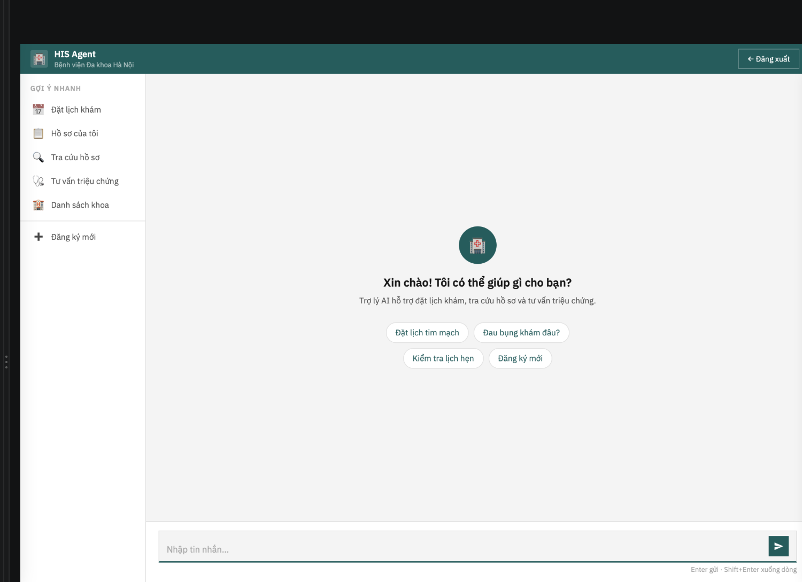
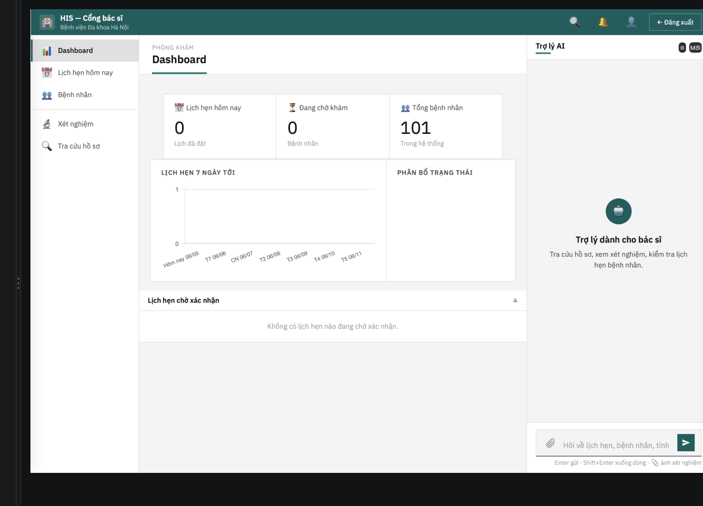
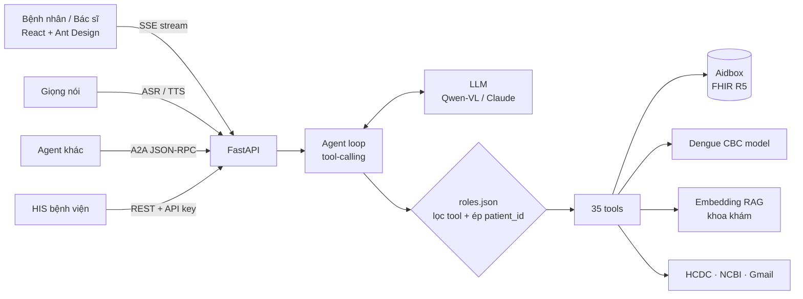

# HIS Agent — Trợ lý AI cho Bệnh viện

> Một AI agent nói tiếng Việt, gắn thẳng vào hệ thống thông tin bệnh viện (HIS) qua chuẩn **HL7 FHIR**.
> Bệnh nhân chat (hoặc **gọi bằng giọng nói**) để được phân luồng, gợi ý khoa, đặt lịch khám, sàng lọc sốt xuất huyết.
> Bác sĩ có một trợ lý hỗ trợ quyết định lâm sàng: tra hồ sơ, đọc phiếu xét nghiệm từ ảnh, dự đoán Dengue từ công thức máu, cảnh báo dị ứng thuốc trước khi kê đơn.


Đồ án tốt nghiệp — Đại học Bách khoa Hà Nội (HUST). Đã deploy lên server bằng Docker Compose.

<table>
  <tr>
    <td width="50%"></td>
    <td width="50%"></td>
  </tr>
  <tr>
    <td align="center"><b>Bệnh nhân</b> — chat với trợ lý: đặt lịch, hồ sơ, tư vấn triệu chứng</td>
    <td align="center"><b>Bác sĩ</b> — dashboard phòng khám + trợ lý AI bên cạnh</td>
  </tr>
</table>

---

## Điểm nổi bật

| | |
|---|---|
| 🤖 **Agent tool-calling tự viết** | Vòng lặp agent không dùng framework (không LangChain), chạy trên OpenAI-compatible SDK nên đổi qua lại Qwen-VL / Claude / OpenRouter chỉ bằng biến môi trường. **35 tool** tự đăng ký theo quy ước `TOOL_NAME` + `run()`. |
| 🏥 **Chuẩn y tế FHIR** | Mọi dữ liệu lâm sàng — Patient, Appointment, Slot, Observation, AllergyIntolerance, MedicationRequest — đọc/ghi qua FHIR R5 trên Aidbox, không phải DB tự chế. |
| 🔐 **Phân quyền 2 lớp chống prompt injection** | Manifest [roles.json](roles.json) vừa chèn luật vào system prompt, vừa **chặn ở tầng tool**: bệnh nhân chỉ gọi được tool trong whitelist, và `patient_id` bị ép từ session — LLM có bị dụ cũng không đọc được hồ sơ người khác. |
| 🩸 **ML dự đoán Dengue từ CBC** | Model huấn luyện trên 1.523 mẫu công thức máu (9 chỉ số), CV F1 = 0.85. Bác sĩ chụp ảnh phiếu xét nghiệm → OCR (Qwen-VL-OCR) → trích chỉ số → dự đoán + đối chiếu phân độ của Bộ Y tế. |
| 🎙️ **Chế độ gọi thoại** | Nói chuyện với agent như gọi điện: ASR → agent → TTS theo từng câu (stream), có lớp chuẩn hoá câu trả lời để TTS đọc đúng ("SXHD" → "sốt xuất huyết", bỏ markdown/emoji). |
| 🔎 **RAG gợi ý khoa khám** | Embedding đa ngôn ngữ (`paraphrase-multilingual-MiniLM-L12-v2`) + cosine similarity trên kho triệu chứng → khoa, kết hợp triage phân mức cấp cứu. |
| 💊 **An toàn kê đơn** | Kiểm tra dị ứng thuốc 4 lớp (trùng tên → cùng nhóm → phản ứng chéo → an toàn) theo Stockley's & BNF; tra cứu thuốc có dẫn nguồn từ NCBI (StatPearls/PubMed). |
| 📈 **Dữ liệu dịch bệnh thật** | Scrape bản tin tuần của HCDC TP.HCM, cache + lazy refresh, so sánh tuần-trên-tuần, luôn trích nguồn. |
| 🔌 **Sẵn sàng tích hợp** | Expose agent qua **A2A protocol** (Agent Card + JSON-RPC) cho agent khác gọi; cổng inbound có API key + chống gửi trùng để HIS bệnh viện đẩy dữ liệu sang, tự ánh xạ sang FHIR. |

---

## Demo nhanh các luồng

**Bệnh nhân**
- *"Tôi sốt 3 ngày, đau mỏi người, nên khám khoa nào?"* → triage + RAG gợi ý khoa → mở checklist sàng lọc SXHD theo tiêu chuẩn Bộ Y tế (4 mức: không / nhẹ / cảnh báo / nặng).
- *"Đặt cho tôi khám Nội thứ Hai tuần sau lúc 10h sáng"* → tìm slot trống → đặt lịch → gửi email xác nhận.
- *"Tôi đau ngực dữ dội, khó thở"* → nhận diện cấp cứu → khuyên gọi 115 ngay, **dừng**, không hỏi thêm.
- Xem hồ sơ, kết quả xét nghiệm, đơn thuốc của **chính mình**; nhận email nhắc uống thuốc theo đơn bác sĩ kê.

**Bác sĩ**
- Dashboard lịch khám hôm nay, duyệt/từ chối lịch hẹn, tra cứu bệnh nhân.
- Upload ảnh phiếu CBC → agent đọc số, vẽ biểu đồ xu hướng, dự đoán nguy cơ Dengue.
- Hoàn tất lượt khám: ghi sinh hiệu, dị ứng, kê đơn (có chặn dị ứng), gửi tóm tắt cho bệnh nhân.

---

## Kiến trúc



**Một vài quyết định thiết kế đáng nói:**

- **Không để LLM tự tính ngày.** Thực tế LLM đặt "thứ Hai tuần sau" thành thứ Ba mà vẫn báo đúng. Giải pháp: LLM chỉ chép nguyên cụm người dùng nói, việc quy đổi ngày giờ tiếng Việt chuyển hẳn sang code ([tools/shared/_vi_dates.py](tools/shared/_vi_dates.py)); không hiểu thì trả lỗi để agent hỏi lại chứ không đoán.
- **System prompt tách theo nghiệp vụ.** Phía bác sĩ có prompt riêng cho hồ sơ / CBC / lịch hẹn thay vì một prompt khổng lồ, giảm nhầm tool.
- **Tool tự mô tả.** Mỗi tool khai báo `DESCRIPTION` + `ARGS_SCHEMA`, agent tự sinh JSON Schema cho function calling — thêm tool mới chỉ cần thả file vào thư mục.
- **Biên nhận minh bạch ở cổng HIS.** Bản tin nhận về luôn được lưu trước; ánh xạ FHIR lỗi cũng không mất dữ liệu, biên nhận báo rõ `persisted_to_fhir` để xử lý lại.

---

## Đánh giá

**Tool-selection accuracy** — [eval_tool_selection.py](eval_tool_selection.py) gửi bộ câu hỏi cho agent (không thực thi tool), so tool được chọn với tool kỳ vọng, mỗi câu chạy 3 lần:

| Nhóm kịch bản | Kết quả |
|---|---|
| Câu hỏi thường | 22 / 24 |
| Cách nói lệch, mơ hồ | 9 / 12 |
| Câu đối nghịch (cố dụ agent vượt quyền) | 6 / 6 |
| Bẫy ngoài phạm vi / chào hỏi | 6 / 6 |
| Nghiệp vụ bác sĩ | 6 / 6 |
| **Tổng** | **49 / 54 (90.7%)** — model `qwen3-vl-plus` |

**Dengue CBC model** — 1.523 mẫu (1.042 dương / 481 âm), 9 đặc trưng (PLT, WBC, HCT, HGB, neutrophils, lymphocytes, monocytes, MPV, RDW): cross-validation F1 = 0.85, AUC = 0.68. Có thêm bản *core* chỉ cần 4 chỉ số cơ bản cho phiếu xét nghiệm rút gọn. Đây là công cụ **hỗ trợ**, không thay chẩn đoán.

---

## Tech stack

| Tầng | Công nghệ |
|---|---|
| LLM | Qwen3-VL (Alibaba DashScope), Claude Haiku 4.5 (Anthropic / OpenRouter) — qua OpenAI-compatible SDK |
| Backend | Python 3.12, FastAPI, Uvicorn, Server-Sent Events, Pydantic |
| Dữ liệu y tế | HL7 FHIR R5 trên Aidbox |
| AI/ML | sentence-transformers, NumPy, scikit-learn (Random Forest / Gradient Boosting), Qwen-VL-OCR |
| Frontend | React 18, TypeScript, Vite, Ant Design, Recharts |
| Auth | SQLite + bcrypt, session token |
| Tích hợp | A2A protocol, NCBI E-utilities, HCDC scraper, Gmail SMTP, ASR/TTS server |
| DevOps | Docker multi-stage (Node build → Python runtime, torch CPU-only), Docker Compose, healthcheck, script deploy 1 lệnh |

---

## Chạy thử

```bash
# Backend
python -m venv venv && source venv/bin/activate
pip install -r requirements.txt
cp .env.example .env         # điền API key LLM + thông tin Aidbox
python main.py               # http://localhost:8000

# Frontend (dev)
cd frontend && npm install && npm run dev
```

Hoặc chạy cả hệ thống bằng Docker:

```bash
docker compose up -d --build
```

Biến môi trường chính: `ALIBABA_API_KEY` hoặc `OPENROUTER_API_KEY` hoặc `ANTHROPIC_API_KEY` (chọn một), `AIDBOX_URL`, `AIDBOX_CLIENT_ID`, `AIDBOX_CLIENT_SECRET`. Tuỳ chọn: `GMAIL_*` (email), `NCBI_API_KEY`, `HIS_API_KEY` (mở cổng HIS), `ASR_URL` / `TTS_URL` (giọng nói).

Hướng dẫn deploy production: [DEPLOY.md](DEPLOY.md).

---

## Cấu trúc thư mục

```
agent.py            Vòng lặp agent: load tool, gọi LLM, stream SSE, OCR ảnh
system_prompt.py    Prompt theo vai trò và theo luồng nghiệp vụ
roles.json          Manifest phân quyền + guardrail
api/                FastAPI: chat, auth, lịch hẹn, FHIR, A2A, cổng HIS, voice, nhắc thuốc
tools/
  fhir/             31 tool thao tác FHIR (đặt lịch, hồ sơ, xét nghiệm, kê đơn, dị ứng…)
  dengue/           Sàng lọc triệu chứng SXHD + dự đoán từ CBC
  outbreak/         Số liệu dịch từ HCDC
  knowledge/        Tra cứu thuốc (NCBI)
  shared/           Aidbox client, RAG, luật dị ứng, quy đổi ngày tiếng Việt
  knowledge_base/   Model ML, phác đồ, kho triệu chứng → khoa
frontend/           React + TypeScript (giao diện bệnh nhân và bác sĩ)
scripts/            Train model, sinh slot, seed dữ liệu, deploy
tests/              Test sàng lọc Dengue và gợi ý khoa
```

---

## Tác giả

**Trương Công Thái Đức** — thiết kế và phát triển toàn bộ hệ thống (backend, agent, ML, frontend, deploy).

> ⚠️ Dự án phục vụ nghiên cứu/đồ án. Mọi kết quả của agent chỉ mang tính tham khảo, không thay thế chẩn đoán của bác sĩ.
